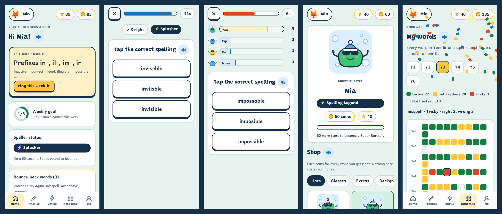

# Vocabursters

**Free weekly spelling games for Year 1 to Year 6 (ages 5 to 11).** Vocabursters turns the 216 weekly spelling and vocabulary tests (1,908 words, following the National Curriculum in England spelling appendix) into games, with a recorded voice reading every word.

There's no login and no adverts, and it works offline. Progress stays on your device.

## Get the app

### 👉 https://richardawe.github.io/vocabursters/


Open the link (or scan the QR code), then add it to your home screen so it opens like an app and works without the internet:

| Device | How to install |
|---|---|
| **iPhone / iPad** | Open the link in **Safari** → tap **Share** → **Add to Home Screen** |
| **Android phone or tablet** | Open the link in **Chrome** → tap **Install** (or **⋮** → **Install app**) |
| **Windows, Mac, Chromebook** | Open the link in **Chrome** or **Edge** → click the install icon in the address bar |

Then tap **Add a player**, type your child's name and choose their school year. That's all.

**Updates** arrive by themselves the next time the app is opened with an internet connection.

**Offline voice:** each player's year of recordings downloads in the background (about 1 MB). To save other years, go to Grown-ups → Install & backup → *Voice for offline use*.

<p align="center"></p>

## What's inside

- **Weekly games:** *Look, Say, Cover, Write, Check*, Bubble Burst, Missing Letters, Spot the Spelling, Word Jumble, Homophone Hero and the Friday Test.
- **Bounce-back words:** missed words come back the following week.
- **Smart practice:** picks the words your child finds hardest.
- **Speed round and Speller status**, with certificates.
- **Bubble Battle:** races against computer rivals.
- **Word map:** a heat map of every word.
- **Rewards:** coins, a pet to dress up, stickers and a family leaderboard.
- **Grown-ups area:** progress, tricky words, settings (including turning timed games off), a printable paper test, and backup to move progress to another device.

## For developers

| Path | What it is |
|---|---|
| `app/src/app.html` | The app (HTML, CSS and JS in one file) |
| `app/public/` | Icons, manifest, service worker, self-hosted fonts and the recorded voice (`audio/`) |
| `data/words.json` | All 216 weekly word lists |
| `data/sentences.json` | Example sentences, including every homophone and apostrophe word |
| `scripts/build.py` | Builds `dist/`, the folder GitHub Pages serves |
| `scripts/generate_voice.py` | Records words and sentences with [Kokoro](https://huggingface.co/hexgrad/Kokoro-82M) (see the file for setup) |
| `scripts/fetch_fonts.py` | Downloads the fonts so the app never contacts Google |
| `.github/workflows/pages.yml` | Builds and deploys to GitHub Pages on every push |
| `ios/`, `android/`, `capacitor.config.json` | Native App Store and Google Play apps (Capacitor); `npm run ios` / `npm run android` |
| `app/site/` | Privacy policy and support pages (linked from the store listings) |
| `store/` | Store listing copy, form answers, screenshots and graphics |
| `.github/workflows/ios.yml`, `android.yml` | Build the apps on every push; run by hand to sign and upload |
| `docs/STORE_RELEASE.md` | Step-by-step: submitting to the App Store and Google Play |
| `docs/PLAN.md` | Product plan |
| `docs/MEMORY.md`, `CLAUDE.md` | Project memory (state, decisions, log) and working notes for Claude |

```sh
python3 scripts/build.py                      # build dist/
python3 -m http.server -d dist 8000           # try it at http://localhost:8000
```

After adding words or sentences, run `scripts/generate_voice.py` to record the new clips (only missing clips are recorded), then commit `app/public/audio/`.

## Credits and licences

- **Voice:** [Kokoro-82M](https://huggingface.co/hexgrad/Kokoro-82M), voice `af_heart` (Apache 2.0).
- **Fonts:** Andika, Atkinson Hyperlegible, Grandstander and Lexend (SIL Open Font License 1.1).
- **Word lists:** based on the National Curriculum in England spelling appendix.
